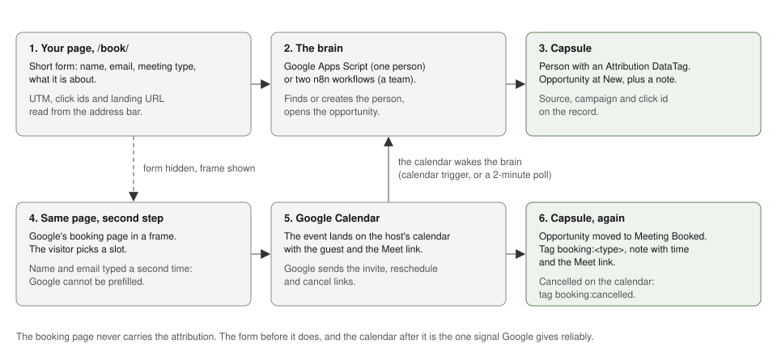

# capsule-google-booking

Free appointment booking for Capsule CRM, built on the booking pages Google Workspace already gives you. Two ways to run it: a Google Apps Script inside your own account for one person, or two n8n workflows for a team.

A visitor fills in a short form on **your** page, which captures who they are and which ad or link brought them. The page then shows a Google appointment page, and the enquiry is written into Capsule. When the slot lands on the calendar, the watcher moves the Capsule opportunity to **Meeting Booked**, tags it, and writes a note with the time, the Meet link and the booking form answers. Cancellations are caught too.

Capture first, then book, then watch the calendar. The booking page never has to carry the attribution, which is the thing Google's page cannot do.

## Status

| | Where it stands |
|---|---|
| Track A (solo, Apps Script) | Running on timmybrown.co.nz since 12 October 2026. A test booking reached Capsule at Meeting Booked two seconds after Google confirmed the slot; the cancellation tag arrived thirty seconds after cancelling from the invite. |
| Track B (team, n8n) | Built from the same design, JSON validated, not yet run against live accounts. The checks in [docs/LESSON-PLAN.md](docs/LESSON-PLAN.md) are what prove it. |



## Two tracks

| | Track A: solo | Track B: team |
|---|---|---|
| For | One calendar, no routing | Several hosts, round robin per meeting type, or you already run n8n |
| Runs on | Google Apps Script (free, in your Google account) | n8n Cloud or self-hosted |
| Files | `appsscript/Code.gs`, `appsscript/appsscript.json`, `form/book-solo.html` | `workflows/booking-router.json`, `workflows/calendar-watcher.json`, `form/book.html` |
| Watcher wakes | Calendar trigger on change, plus a 15-minute timer | Two-minute poll across host calendars |
| Set-up | About 45 minutes | About 90 minutes |

Both tracks share the Capsule schema in [capsule/SCHEMA.md](capsule/SCHEMA.md) and the step-by-step [docs/LESSON-PLAN.md](docs/LESSON-PLAN.md).

## What it costs

Nothing beyond what you already pay for. Google appointment schedules come with Workspace and with personal Google accounts. Apps Script is free. Capsule's API needs a plan that includes it. Track B adds n8n: its smallest cloud plan, or nothing if you self-host.

The edition note: Google's premium scheduling features (several booking pages per person, automatic email reminders, checking more than one calendar) need Business Standard or above, Workspace Individual, or Google One Premium. Business Starter and personal accounts get one booking page per person, so two meeting types means an upgrade or one schedule. The Capsule Free plan allows one pipeline and five custom fields, so on Free keep the attribution in the note and skip the DataTag.

## What you need

- A Google account per host, with an appointment schedule for each meeting type.
- A Capsule account with API access and the milestones described in [capsule/SCHEMA.md](capsule/SCHEMA.md).
- Track B only: n8n, reachable over HTTPS.
- A page on your website you can paste a form into.

## Track A in about 45 minutes

1. **Capsule.** Make sure the milestones exist (or run `createMilestones()` from the script later). Make a personal access token.
2. **Google.** Create one appointment schedule per meeting type. Copy each one's long URL from Share, then Website embed.
3. **Apps Script.** New project at script.google.com. Paste `appsscript/Code.gs` and `appsscript/appsscript.json`. Add `CAPSULE_TOKEN` and `FORM_SECRET` as Script Properties. Edit `CONFIG`. Run `setup()` once and approve the permissions. Run `testBooking()` and look in Capsule.
4. **Deploy.** Deploy, then New deployment, Web app, execute as Me, access Anyone. Copy the `/exec` URL.
5. **The page.** Put `form/book-solo.html` at `/book/` on your site. Set `SCRIPT_URL`, `FORM_SECRET` and the two `BOOKING_PAGES` URLs.
6. **Test with yourself.** Open `/book/?utm_source=test`, submit, book a slot. Within a minute or two Capsule shows the person at Meeting Booked with two notes. Cancel from the invite and watch the tag arrive.

## Track B in about 90 minutes

1. **Capsule.** Milestones, optional Attribution DataTag, personal access token.
2. **Google.** One appointment schedule per meeting type per host; copy the embed URLs.
3. **n8n credentials.** Header Auth for Capsule (`Authorization`, `Bearer <token>`) and Google Calendar OAuth2 for an account that can read every host's calendar.
4. **Router.** Import `workflows/booking-router.json`, select the Capsule credential on each Capsule node, edit the Settings node, activate, copy the production webhook URL.
5. **Watcher.** Import `workflows/calendar-watcher.json`, select both credentials, edit its Settings node, run once by hand, activate.
6. **The form.** Put `form/book.html` at `/book/`, set `N8N_WEBHOOK`, and replace `*` in the router's Webhook node with your site's origin.
7. **Test with yourself**, as above.

## How it works

```
your page /book/            the brain (Apps Script or n8n)            Capsule
  step 1 form  ───POST────▶ find or create person ──────────────────▶ Person (+ Attribution DataTag)
                            open opportunity or create at "New" ───▶ Opportunity, tags, note

your page /book/            Google
  step 2 frame ───────────▶ host's appointment page ────────────────▶ event on the host's calendar
                                                                           │
                            the brain, woken by the calendar               │
                            events changed since last time ◀───────────────┘
                            outside guest? not seen before?
                            move to "Meeting Booked" ───────────────▶ tag booking:<type>, note with time + Meet link
                            cancelled? ─────────────────────────────▶ tag booking:cancelled, note
```

Why watch the calendar instead of the booking page: Google's appointment pages have no webhook, no redirect after booking and no URL prefill. The calendar event is the only reliable signal, and the Calendar API can be read by anyone with access to the calendar. On Track A, Google fires the script the moment the calendar changes.

Why the solo page shows the Google page before the CRM write finishes: Apps Script web apps answer with a redirect the browser cannot read cross-origin, and a CRM hiccup must never cost a booking. The write is fire-and-forget; the watcher creates the person anyway if it failed.

## What you lose compared with a paid scheduler

- **No SMS reminders.** Email reminders need Google's premium tier, and the reminder text cannot be edited.
- **The visitor types their name and email twice**: once on your form, once on Google's. Google's page cannot be prefilled.
- **No instant client-side conversion fire** on a thank-you page, because there is no redirect. Conversions fire from the watcher within a minute or two, which is better for attribution anyway: server-side, deduplicated on the event id.
- **Google branding** on the booking page.
- **Routing is round robin per meeting type** on Track B and single-host on Track A.

If any of those matter more than the saving, keep your scheduler and use only the Capsule half. The watcher does not care what put the event on the calendar.

## Limits and failure modes

- Track A remembers seen events (id plus `updated` stamp) in Script Properties and uses the Calendar API's sync token, so edits and reschedules are picked up and nothing is written twice. `fullResync()` clears both.
- Track A's web app accepts anonymous posts, so the page sends a shared `FORM_SECRET` and a honeypot field. It is spam resistance, not security; nothing sensitive is reachable through it.
- Track B pairs responses to hosts by position and advances its window only when every Google call succeeded, so a bad hour does not lose bookings.
- Any event on a host's calendar with an outside guest counts as a booking unless `SUMMARY_MATCH` (Track A) or `summary_match` (Track B) limits it to your schedule titles. Set it if the calendar also holds other external meetings.
- Capsule search is fuzzy, so people are only reused on an exact email match.
- Apps Script quotas (trigger runtime per day, external requests per day) are far above what one person's bookings need.

## Adapting it

Any CRM with a REST API will do. Track A: replace the Capsule helpers at the bottom of `Code.gs`. Track B: swap the eight `Capsule:` HTTP nodes in each workflow. The Google side and the form do not change.

## Why I built it

The reasoning, the gap in the two marketplaces this falls into, and what each tool pays me are in the article that accompanies this repo: [Free Appointment Scheduling for Capsule CRM](https://4quadrantai.com/articles/free-appointment-scheduling-capsule-crm/) on 4quadrantai.com, with the three things Google's booking page cannot do written up [on their own](https://4quadrantai.com/articles/google-appointment-schedule-webhook-redirect-prefill/). This repository carries no affiliate links.

## Licence

MIT. Use it, change it, sell your time installing it. If you improve either track, a pull request is welcome.
