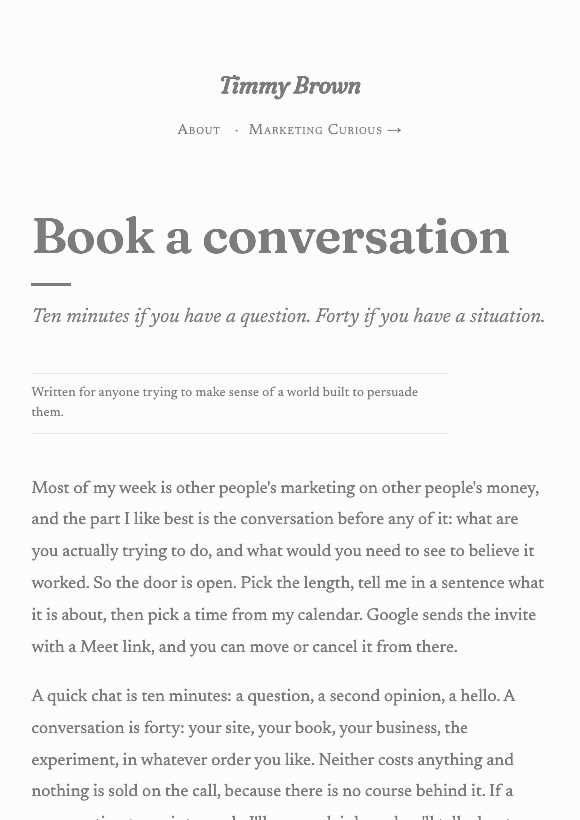

# Capsule Google Booking

**Free appointment scheduling for Capsule CRM, built on the Google Calendar appointment schedules (booking pages) you already have.** Capture the visitor and their UTM attribution first, then show Google's booking page, then watch the calendar and move the Capsule opportunity to *Meeting Booked*. Runs as one Google Apps Script for a single person, or two n8n workflows for a team. A third track swaps Google's booking page for Cal.com's free plan, which sends a webhook and accepts a prefilled name and email.

[](LICENSE)
[](#status)
[](#status)
[](#status)
[](appsscript/)
[](workflows/)



A visitor fills in a short form on **your** page, which captures who they are and which ad or link brought them. The page then shows a Google appointment page, and the enquiry is written into Capsule. When the slot lands on the calendar, the watcher moves the Capsule opportunity to **Meeting Booked**, tags it, and writes a note with the time, the Meet link and the booking form answers. Cancellations are caught too.

Capture first, then book, then watch the calendar. The booking page never has to carry the attribution, which is the thing Google's page cannot do.

## Contents

- [Status](#status)
- [Three tracks](#three-tracks)
- [What it costs](#what-it-costs)
- [What you need](#what-you-need)
- [Track A in about 45 minutes](#track-a-in-about-45-minutes)
- [Track B in about 90 minutes](#track-b-in-about-90-minutes)
- [Track C in about 40 minutes](#track-c-in-about-40-minutes)
- [How it works](#how-it-works)
- [What you lose compared with a paid scheduler](#what-you-lose-compared-with-a-paid-scheduler)
- [Limits and failure modes](#limits-and-failure-modes)
- [Adapting it to another CRM](#adapting-it-to-another-crm)
- [FAQ](#faq)
- [The tools it runs on](#the-tools-it-runs-on)
- [Why I built it](#why-i-built-it)
- [Contributing, security and citing](#contributing-security-and-citing)
- [Licence](#licence)

## Status

| | Where it stands |
|---|---|
| Track A (solo, Apps Script) | Running on timmybrown.co.nz since 12 October 2026. A test booking reached Capsule at Meeting Booked two seconds after Google confirmed the slot; the cancellation tag arrived thirty seconds after cancelling from the invite. |
| Track B (team, n8n) | Built from the same design, JSON validated, not yet run against live accounts. The checks in [docs/LESSON-PLAN.md](docs/LESSON-PLAN.md) are what prove it. |
| Track C (solo, Cal.com) | Added 24 November 2026. The script passes its checks against a simulated Capsule, with webhook payloads built from the fields Cal.com documents. The page's embed loads a public Cal.com booking link with the name, email and booking key filled in. No real Cal.com webhook has reached it yet, so treat the first booking as the test. |

Changes are listed in [CHANGELOG.md](CHANGELOG.md).

## Three tracks

| | Track A: solo | Track B: team |
|---|---|---|
| For | One calendar, no routing | Several hosts, round robin per meeting type, or you already run n8n |
| Runs on | Google Apps Script (free, in your Google account) | n8n Cloud or self-hosted |
| Files | `appsscript/Code.gs`, `appsscript/appsscript.json`, `form/book-solo.html` | `workflows/booking-router.json`, `workflows/calendar-watcher.json`, `form/book.html` |
| Watcher wakes | Calendar trigger on change, plus a 15-minute timer | Two-minute poll across host calendars |
| Set-up | About 45 minutes | About 90 minutes |

**Track C: solo, with Cal.com.** The same form and the same Capsule writes as Track A, with Cal.com's free plan as the slot picker instead of Google's page. Files: `cal/Code.gs`, `cal/appsscript.json`, `form/book-cal.html`.

- Cal.com sends a webhook when a booking is created, rescheduled or cancelled, so there is no calendar watcher and no timer.
- The page passes the name and email to Cal.com, so the visitor types them once.
- The page also passes a booking key, which Cal.com hands back in the webhook. The booking joins the form record even if the visitor books under another email.
- Cal.com's free plan has no cap on booking links, so two meeting types need no Google upgrade.
- It adds one more account and Cal.com's branding. Track A needs neither.

All three tracks share the Capsule schema in [capsule/SCHEMA.md](capsule/SCHEMA.md) and the step-by-step [docs/LESSON-PLAN.md](docs/LESSON-PLAN.md).

## What it costs

Nothing beyond what you already pay for. Google appointment schedules come with Workspace and with personal Google accounts. Apps Script is free. Capsule's API needs a plan that includes it. Track B adds n8n: its smallest cloud plan, or nothing if you self-host. Track C uses Cal.com's free plan, which covers one user, webhooks and any number of booking links (read from its pricing page on 24 November 2026).

The edition note: Google's premium scheduling features (several booking pages per person, automatic email reminders, checking more than one calendar) need Business Standard or above, Workspace Individual, or Google One Premium. Business Starter and personal accounts get one booking page per person, so two meeting types means an upgrade or one schedule. The Capsule Free plan allows one pipeline and five custom fields, so on Free keep the attribution in the note and skip the DataTag.

## What you need

- A Google account per host, with an appointment schedule for each meeting type.
- A Capsule account with API access and the milestones described in [capsule/SCHEMA.md](capsule/SCHEMA.md).
- Track B only: n8n, reachable over HTTPS.
- A page on your website you can paste a form into.

## Track A in about 45 minutes

1. **Capsule.** Make sure the milestones exist (or run `createMilestones()` from the script later). Make a personal access token.
2. **Google.** Create one appointment schedule per meeting type. Copy each one's long URL from Share, then Website embed.
3. **Apps Script.** New project at script.google.com. Paste `appsscript/Code.gs` and `appsscript/appsscript.json`. Add `CAPSULE_TOKEN` and `FORM_SECRET` as Script Properties. Edit `CONFIG`. Run `setup()` once and approve the permissions. Run `testBooking()` and look in Capsule.
4. **Deploy.** Deploy, then New deployment, Web app, execute as Me, access Anyone. Copy the `/exec` URL.
5. **The page.** Put `form/book-solo.html` at `/book/` on your site. Set `SCRIPT_URL`, `FORM_SECRET` and the two `BOOKING_PAGES` URLs.
6. **Test with yourself.** Open `/book/?utm_source=test`, submit, book a slot. Within a minute or two Capsule shows the person at Meeting Booked with two notes. Cancel from the invite and watch the tag arrive.

## Track B in about 90 minutes

1. **Capsule.** Milestones, optional Attribution DataTag, personal access token.
2. **Google.** One appointment schedule per meeting type per host; copy the embed URLs.
3. **n8n credentials.** Header Auth for Capsule (`Authorization`, `Bearer <token>`) and Google Calendar OAuth2 for an account that can read every host's calendar.
4. **Router.** Import `workflows/booking-router.json`, select the Capsule credential on each Capsule node, edit the Settings node, activate, copy the production webhook URL.
5. **Watcher.** Import `workflows/calendar-watcher.json`, select both credentials, edit its Settings node, run once by hand, activate.
6. **The form.** Put `form/book.html` at `/book/`, set `N8N_WEBHOOK`, and replace `*` in the router's Webhook node with your site's origin.
7. **Test with yourself**, as above.

## Track C in about 40 minutes

1. **Capsule.** As Track A: the milestones and a personal access token.
2. **Cal.com.** Connect your calendar and make one booking link per meeting type. Note each link's slug, the last part of its address.
3. **Apps Script.** New project at script.google.com. Paste `cal/Code.gs` and `cal/appsscript.json`. Add `CAPSULE_TOKEN`, `FORM_SECRET` and `WEBHOOK_KEY` as Script Properties. Edit `CONFIG`, setting each meeting type's `slug`. Run `setup()` once, then `testBooking()`, and look in Capsule.
4. **Deploy.** Deploy, then New deployment, Web app, execute as Me, access Anyone. Copy the `/exec` URL.
5. **The webhook.** In Cal.com open Settings, Developer, Webhooks, and add one. The subscriber URL is the `/exec` URL with `?key=` and your `WEBHOOK_KEY` on the end. Tick Booking created, Booking rescheduled and Booking cancelled. Leave the payload template on the default.
6. **The page.** Put `form/book-cal.html` at `/book/` on your site. Set `SCRIPT_URL`, `FORM_SECRET` and the two `CAL_LINKS`, each written as `yourname/slug`.
7. **Test with yourself.** Open `/book/?utm_source=test`, submit, book a slot. Capsule shows the person at Meeting Booked with two notes. Reschedule and cancel from the confirmation email and watch a note arrive for each.

## How it works


<details>
<summary>The same flow as text</summary>

```
your page /book/            the brain (Apps Script or n8n)            Capsule
  step 1 form  ───POST────▶ find or create person ──────────────────▶ Person (+ Attribution DataTag)
                            open opportunity or create at "New" ───▶ Opportunity, tags, note

your page /book/            Google
  step 2 frame ───────────▶ host's appointment page ────────────────▶ event on the host's calendar
                                                                           │
                            the brain, woken by the calendar               │
                            events changed since last time ◀───────────────┘
                            outside guest? not seen before?
                            move to "Meeting Booked" ───────────────▶ tag booking:<type>, note with time + Meet link
                            cancelled? ─────────────────────────────▶ tag booking:cancelled, note
```

</details>

Why watch the calendar instead of the booking page: Google's appointment pages have no webhook, no redirect after booking and no URL prefill. The calendar event is the only reliable signal, and the Calendar API can be read by anyone with access to the calendar. On Track A, Google fires the script the moment the calendar changes.

Why the solo page shows the Google page before the CRM write finishes: Apps Script web apps answer with a redirect the browser cannot read cross-origin, and a CRM hiccup must never cost a booking. The write is fire-and-forget; the watcher creates the person anyway if it failed.

## What you lose compared with a paid scheduler

- **No SMS reminders.** Email reminders need Google's premium tier, and the reminder text cannot be edited.
- **The visitor types their name and email twice**: once on your form, once on Google's. Google's page cannot be prefilled.
- **No instant client-side conversion fire** on a thank-you page, because there is no redirect. Conversions fire from the watcher within a minute or two, which is better for attribution anyway: server-side, deduplicated on the event id.
- **Google branding** on the booking page.
- **Routing is round robin per meeting type** on Track B and single-host on Track A.

Track C changes three of these. The visitor types their name and email once. Cal.com's branding replaces Google's on the free plan. A redirect to your own thank-you page exists on Cal.com but is listed for paid plans only, so conversions still fire from the script.

If any of those matter more than the saving, keep your scheduler and use only the Capsule half. The watcher does not care what put the event on the calendar.

## Limits and failure modes

- Track A remembers seen events (id plus `updated` stamp) in Script Properties and uses the Calendar API's sync token, so edits and reschedules are picked up and nothing is written twice. `fullResync()` clears both.
- Track A's web app accepts anonymous posts, so the page sends a shared `FORM_SECRET` and a honeypot field. It is spam resistance, not security; nothing sensitive is reachable through it.
- Track B pairs responses to hosts by position and advances its window only when every Google call succeeded, so a bad hour does not lose bookings.
- Any event on a host's calendar with an outside guest counts as a booking unless `SUMMARY_MATCH` (Track A) or `summary_match` (Track B) limits it to your schedule titles. Set it if the calendar also holds other external meetings.
- Track C cannot check Cal.com's webhook signature, because an Apps Script web app cannot read request headers. It checks a key on the end of the webhook URL instead, so treat that full URL as a password. It remembers each booking it has handled, so a webhook delivered twice writes once. Cal.com's help pages do not say whether a failed booking webhook is retried; if a booking is missing from Capsule, look at the script's Executions list.
- Track C drops the booking key when the visitor uses the "open in a new tab" link, and Cal.com's cancellation webhook carries no metadata. Both cases fall back to matching the person by email.
- Capsule search is fuzzy, so people are only reused on an exact email match.
- Apps Script quotas (trigger runtime per day, external requests per day) are far above what one person's bookings need.

## Adapting it to another CRM

Any CRM with a REST API will do. Track A: replace the Capsule helpers at the bottom of `Code.gs`. Track B: swap the eight `Capsule:` HTTP nodes in each workflow. The Google side and the form do not change. The CRM has to be able to find a person by email, create one, open a deal, move its stage and add a note.

## FAQ

**Does Google Calendar appointment scheduling have a webhook?**
No. Google's booking page tells nobody about a booking. This project watches the calendar instead: an installable calendar trigger in Apps Script, or a short poll in n8n, reads what changed through the Calendar API and treats a new event with an outside guest as a booking.

**Can Google's booking page redirect to a thank-you page or be prefilled from the URL?**
No to both. That is why the form comes first: the attribution is captured on your page before the visitor sees Google's, and conversions fire from the watcher rather than from a thank-you page. The visitor types their name and email a second time on Google's form.

**Is this a free Calendly alternative?**
For booking a slot and getting the booking into Capsule with its source, yes. It gives up SMS reminders, Google's form prefill and an instant thank-you page. See [what you lose](#what-you-lose-compared-with-a-paid-scheduler).

**Do I need Google Workspace?**
No. A personal Google account can create one appointment schedule. Several booking pages per person, automatic reminders and multi-calendar clash checks need a paid edition, listed under [what it costs](#what-it-costs).

**Does it work on Capsule's Free plan?**
Capsule documents API access on every plan. Free allows five custom fields and one pipeline, so keep the attribution in the note and skip the Attribution DataTag.

**Can I put the booking link in Transpond emails?**
Yes. Point the link at your own `/book/` page with the campaign in the UTM parameters, not at Google's URL, so the click is captured the same way an ad click is. Follow-up can hang off the *Meeting Booked* milestone in Capsule's own workflow automation.

**Does Google's booking page load inside an iframe?**
Yes. The Website embed URL from the schedule's Share menu loads in a frame, and both booking pages also show a link that opens it in a new tab.

**Does Cal.com work with Capsule CRM?**
Cal.com's app store lists no Capsule integration (checked 22 November 2026). Track C fills that gap with Cal.com's webhook and a short script. It also keeps the ad or link that brought the visitor, because your own form still comes first.

**Can I use it with HubSpot, Pipedrive or another CRM?**
Yes, by swapping the CRM calls. See [adapting it](#adapting-it-to-another-crm).

## The tools it runs on

| Tool | What it does here | Link |
|---|---|---|
| Capsule CRM | Holds the person, the opportunity, the Attribution DataTag and the booking notes | [capsulecrm.com](https://timmybrown.co.nz/go/capsule-crm/) |
| n8n | Runs Track B for a team; not needed for Track A | [n8n.io](https://timmybrown.co.nz/go/n8n/) |
| Cal.com | The booking page on Track C; not needed for Tracks A or B | [cal.com](https://cal.com) |
| Google appointment schedules | The booking page itself, free with any Google account | [Google Calendar Help](https://support.google.com/calendar/answer/10729749) |
| Google Apps Script | Runs Track A in your own Google account, free | [script.google.com](https://script.google.com) |

The Cal.com link is a plain link. The Capsule and n8n links are affiliate links: they go through a disclosure page on my site, and if you sign up through them I earn a commission at no cost to you. The recipe works the same without them, and what each programme pays is listed in [the article](https://4quadrantai.com/articles/free-appointment-scheduling-capsule-crm/#what-each-one-pays-me).

## Why I built it

The reasoning, the gap in the two marketplaces this falls into, and what each tool pays me are in the article that accompanies this repo: [Free Appointment Scheduling for Capsule CRM](https://4quadrantai.com/articles/free-appointment-scheduling-capsule-crm/) on 4quadrantai.com. The three things Google's booking page cannot do are written up [on their own](https://4quadrantai.com/articles/google-appointment-schedule-webhook-redirect-prefill/). The only affiliate links in this repository are the two disclosed under [the tools it runs on](#the-tools-it-runs-on).

Built by [Timmy Brown](https://timmybrown.co.nz), a marketer in New Zealand.

## Contributing, security and citing

- **Contributing.** Issues and pull requests are welcome; read [CONTRIBUTING.md](CONTRIBUTING.md) first. Everyone taking part follows the [code of conduct](CODE_OF_CONDUCT.md).
- **Security.** Never paste a Capsule token, a Google URL with keys in it or a form secret into an issue. Report a vulnerability privately as described in [SECURITY.md](SECURITY.md).
- **Citing.** GitHub's "Cite this repository" button reads [CITATION.cff](CITATION.cff).

## Licence

MIT. Use it, change it, sell your time installing it. If you improve either track, a pull request is welcome.
